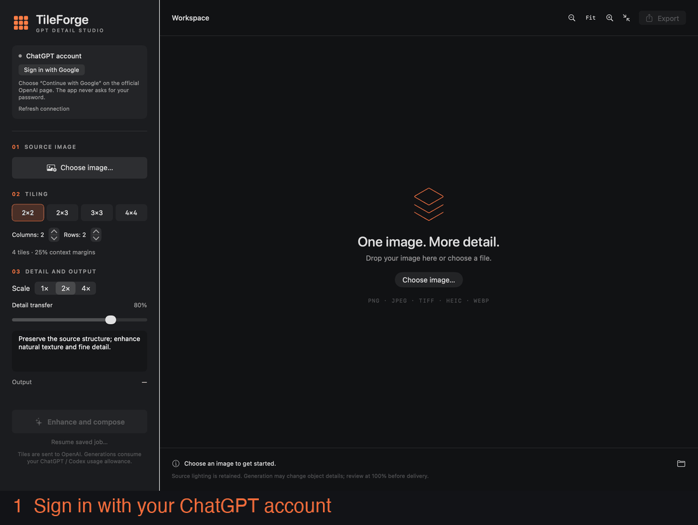
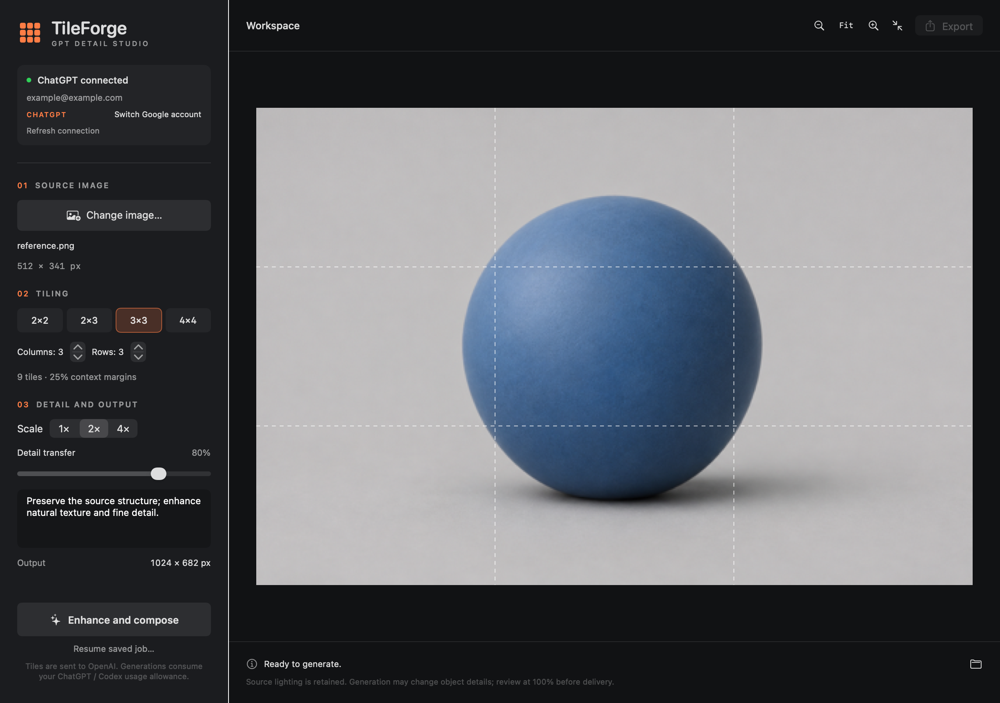
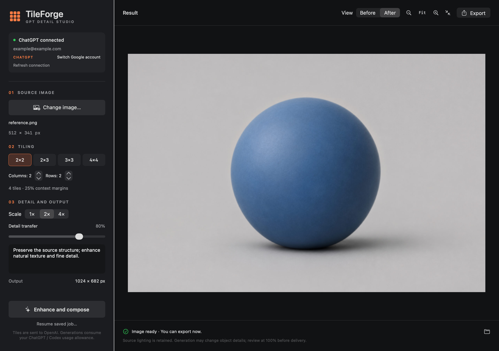

<p align="center">
  
</p>

<h1 align="center">TileForge</h1>

<p align="center"><b>Add natural-looking detail to your images, one overlapping tile at a time, using the ChatGPT account you already have.</b><br>
A professional-grade, native macOS workflow that anyone can use: drop in an image, pick a grid, export. No API key. No Python environment. No GPU setup.</p>

<p align="center">
  <a href="https://github.com/grafikirim1-ai/TileForge/releases/latest"></a>
  
  
  <a href="LICENSE"></a>
</p>

<p align="center">
  
</p>
<p align="center"><sub>Walkthrough built from real SwiftUI renders of the app with placeholder data, not from a live generation run.</sub></p>

## Built for real work

TileForge is meant to be dependable in a professional workflow, not a one-click toy: exact integer grid coverage, orientation-aware sRGB import with alpha preservation, 300 DPI PNG/TIFF export, per-tile persistence with resume, one-click resume after a Codex error (nothing is retried behind your back, so usage never repeats without you), source files never overwritten, and honest diagnostics instead of quality claims. It is a native app you install in a minute, and anyone with a ChatGPT account can use it.

## Why TileForge?

Most image enlargers either stretch what you have or run a local super-resolution model (for example [Upscayl](https://github.com/upscayl/upscayl) or [HiPixel](https://github.com/okooo5km/HiPixel)): faithful, but they add little new texture. Tile-by-tile regeneration exists too, mainly as Stable Diffusion workflows such as [Ultimate SD Upscale](https://github.com/ssitu/ComfyUI_UltimateSDUpscale) in ComfyUI, which need a GPU or a cloud setup, models and node graphs.

TileForge brings that tile-and-regenerate idea to a **native macOS app that runs on your ChatGPT account**: no API key, no GPU, no model downloads, no node graph. We are not aware of another native macOS app that does it this way.

1. It **splits your image into an overlapping grid** (up to 8×8, 25% context margin on every side).
2. For every tile it asks GPT's built-in image tool to **re-render the crop with natural detail**, giving it the full image as a reference so lighting and layout stay anchored.
3. It **re-aligns, tone-matches and blends** the tiles back together with cosine overlap blending, keeping the original low-frequency lighting and transferring only the generated fine detail.

**What this is, and is not:** the output is generative reconstruction aimed at large, print-oriented results (up to 48 MP, 300 DPI metadata on PNG/TIFF export). It is not lossless: new detail is invented by a model, so features can shift and text can distort. Review at 100% before you deliver anything.

You get a high-resolution result you can compare **Before / After**, inspect at 100%, and export as PNG or TIFF. Jobs are saved tile by tile, so a cancelled or failed run can be **resumed** without paying for finished tiles again.

## Highlights

- **Uses your ChatGPT plan through the official Codex CLI.** Sign in with the normal OpenAI page. TileForge never sees your password, never extracts tokens and never calls private endpoints.
- **Native SwiftUI app**, dark UI, drag and drop, live progress with the latest tile preview.
- **Grid presets and custom grids** (2×2, 2×3, 3×3, 4×4, or 1–8 per axis), 1× / 2× / 4× output, adjustable detail transfer and your own instruction text.
- **Seam-aware compositing:** exact integer grid coverage, bounded translation correction, overlap blending.
- **Safe by design:** source files are never overwritten, per-tile persistence and **one-click resume**: if Codex errors out or you quit, the interrupted job is restored on launch and the main button becomes **Resume where you left off**, reusing every finished tile. Nothing is retried automatically, so you never pay for surprise repeats.
- **Honest diagnostics:** overlap error is shown as a diagnostic, never as a quality guarantee.

<p align="center">
  
  
</p>

## Quick start

1. Download `TileForge.dmg.zip` from the [latest release](https://github.com/grafikirim1-ai/TileForge/releases/latest), unzip it and drag **TileForge** to Applications.
2. The build is not Apple-notarized yet: right-click the app and choose **Open** the first time (or run `xattr -dr com.apple.quarantine /Applications/TileForge.app`).
3. Sign in with your ChatGPT account, drop in an image, pick a grid and press **Enhance and compose**.

## FAQ

**Is it free?** TileForge is free and MIT-licensed. Each tile consumes your ChatGPT/Codex usage allowance, so your plan limits and any applicable charges still apply.

**Does it send my images to OpenAI?** Yes. Each tile and the reference image are sent to OpenAI for generation. Do not use it on images you are not allowed to upload.

**Will it keep faces and text exactly?** Not guaranteed. This is generative reconstruction: GPT can invent texture, shift features, alter identity or distort text. Always review at full resolution before delivering anything.

**Intel Macs / Windows / Linux?** Not yet. The packaged runtime is Apple Silicon only. Contributions are welcome.

## Roadmap and ideas (help wanted)

- Developer ID signing and notarization for a normal Gatekeeper experience
- Intel and universal builds
- Side-by-side zoom and seam heat-map viewer
- Batch mode and a command-line interface
- Real before/after example gallery contributed by users
- Interface localization

See [CONTRIBUTING.md](CONTRIBUTING.md). Issues and pull requests are welcome.

## Requirements and download

- macOS 14 or later and an Apple Silicon Mac (M1 or later).
- An internet connection and a ChatGPT/Codex account with access to the built-in image generation tool. Availability and usage limits depend on your account and the runtime.
- Enough free memory and disk space for the source, generated tiles and output. Large jobs can use several GB of RAM.

Download the DMG from [GitHub Releases](https://github.com/grafikirim1-ai/TileForge/releases/latest). No installer or Codex binary is included in this source tree.

Packaged builds are **ad-hoc signed and not Apple-notarized**. Gatekeeper may block them. A normal trusted installation experience requires Developer ID signing and notarization; no signing certificate is included. Intel builds have not been verified.

## Sign in and use

1. Open the DMG, drag TileForge to Applications, and open the app.
2. Click **Sign in with Google**. On the official OpenAI page in your browser, select **Continue with Google** using the account linked to your ChatGPT plan. The app never asks for your Google or ChatGPT password. Provider selection is handled by OpenAI. An existing local Codex ChatGPT session may already be connected.
3. Choose or drop an image. Select columns and rows: presets are 2×2, 2×3, 3×3 and 4×4; custom values range from 1 to 8 per axis.
4. Choose 1×, 2× or 4× output scale, detail strength and an optional instruction. Click **Enhance and compose**.
5. Compare **Before** and **After**, inspect joins at 100%, then export PNG or TIFF.

Images, reference images and tiles are sent to OpenAI for generation. Each tile consumes ChatGPT/Codex usage and can take several minutes. No API key does **not** mean unlimited or free processing: subscription costs, account allowances and any applicable usage charges still matter. There is no paid API fallback. TileForge avoids automatic retries to prevent unexpected repeated usage.

The latest interrupted job is restored automatically on launch; click **Resume where you left off** to continue with its saved settings and finished tiles. To open a different job, click **Resume saved job** and select `job.json` in the job folder. Completed tiles are retained after cancellation or failure. The folder button opens jobs stored under `~/Library/Application Support/TileForge/Jobs/`. Job folders contain source copies, tile inputs, generated images, logs, status and results; treat them as private data. Source files are never overwritten by generation; export to a separate filename to preserve your original.

Switching ChatGPT accounts also changes the local Codex session used by other Codex clients.

## How it works and limitations

TileForge imports an orientation-aware sRGB image, divides it into an integer grid and adds 25% context margins per side. Each GPT edit receives its crop and a full-image reference. Generated crops are resampled to the target geometry, with bounded translation correction when it improves alignment. The compositor retains source low-frequency lighting, transfers generated fine detail and blends overlaps with cosine weights.

This is generative reconstruction, not recovery of provably authentic detail. GPT can invent texture, move features, change identity, distort text or alter geometry. Invisible seams and exact semantic preservation are not guaranteed. Tone stabilization and global translation cannot repair every local warp. Always review full-resolution output; an overlap diagnostic is not a quality certification.

- Source and output are capped at 48 megapixels.
- Output is 8-bit sRGB with alpha support. PNG/TIFF exports carry 300 DPI metadata; that metadata alone adds no detail.
- RAW, CMYK, vector and PDF workflows are not supported.
- One generation is requested per tile, with a 15-minute timeout. Interrupted work can be resumed, but incomplete tiles may consume usage again.
- Authentication and image generation depend on Codex and account capabilities, which may change. TileForge does not extract tokens, call private endpoints or automate the browser.
- Image-quality testing has been limited; historical notes in [docs/VERIFICATION.md](docs/VERIFICATION.md) do not establish broad photographic quality or current release certification.

## Illustrated guide

The [illustrated PDF guide](output/pdf/TileForge_Visual_Guide.pdf) and [offline HTML companion](output/pdf/TileForge_Visual_Guide.html) are in English and include nine illustrated steps with screenshots of the English interface.

## Build from source

Install Xcode Command Line Tools with a Swift 6 or newer toolchain on macOS. The Swift package declares no external package dependencies.

```sh
swift build
swift test
```

If SwiftPM manifest sandboxing is unavailable in your build environment, `swift build --disable-sandbox` and `swift test --disable-sandbox` are alternatives for a trusted checkout.

A Swift build produces the executable but does not bundle Codex. To create a self-contained app, provide an already installed official Codex runtime (the original project used CLI 0.171.0). The packaging script locates the vendor directory through `codex` on PATH, or accepts `TILEFORGE_CODEX_VENDOR` pointing to a directory containing `bin/`, `codex-path/` and `codex-package.json`:

```sh
python3 scripts/package.py
python3 scripts/make-dmg.py
```

These create `dist/TileForge.app` and `dist/TileForge.dmg`. Packaging builds the release executable and ad-hoc signs it with `codesign`; DMG creation uses `hdiutil`. Use a runtime matching your architecture. The optional icon is included if `tmp/AppIcon.icns` exists. To generate the optional icon, run `swift scripts/icon.swift tmp/AppIcon.iconset`, then `iconutil -c icns tmp/AppIcon.iconset -o tmp/AppIcon.icns`. Packaging does not download Codex. Confirm the bundled runtime version and its notices before distributing a different version.

To rebuild the English guide, first run `swift build`, then `python3 scripts/make-guide-screens.py`. Run `scripts/build-guide.py` in a Python environment with ReportLab, Pillow and PyMuPDF installed. Screen rendering currently assumes the Apple Silicon debug build path and will show the current English UI.

`ForgeCheck CODEX SOURCE OUTPUT_DIR` is an optional live integration check that performs four real tile generations and consumes account usage. Add `account-only` for an account-only check. These checks require a suitable signed-in account and internet access; they are separate from offline unit tests.

## License and third-party notices

TileForge is licensed under the [MIT License](LICENSE), Copyright (c) 2026 TileForge contributors.

The bundled OpenAI Codex runtime is separately licensed under Apache-2.0. Its required license and NOTICE are retained in [licenses/](licenses/). Packaging copies that directory into the app bundle. TileForge is an independent integration and is not an OpenAI product.
